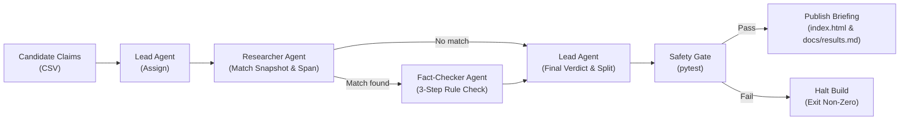

# AWS re:Invent Morning Briefing — Multi-Agent Claim Verification Pipeline

**Live Briefing Demo:** **[https://hurifajri.github.io/reinvent-briefing/](https://hurifajri.github.io/reinvent-briefing/)**

An end-to-end **multi-agent AI verification pipeline and auditable static briefing demo** built with **LangGraph**, **LangSmith**, and **`pytest` safety gates**.

---

## What Is This Project?

This repository is an **applied AI reference implementation and case study**—not a general-purpose library—demonstrating how to put deterministic guardrails, verbatim grounding, and release gates around LLM agents before publishing AI-generated intelligence.

### Real-World Context

Leading up to major cloud conferences like **AWS re:Invent**, launch claims circulate rapidly across social feeds, Reddit threads, Hacker News, and third-party blogs. Some reflect real **Generally Available (GA)** launches, others quietly inflate a **limited preview** or **single-Region rollout** into a global GA claim, and some are pure rumor.

If Solutions Architects repeat unverified or overstated claims to enterprise customers, it directly erodes trust and misleads architecture decisions. This pipeline solves that problem by generating a daily **Morning Briefing** under one strict contract: **an item is only marked Confirmed if it proves every asserted fact word-for-word against official `aws.amazon.com` documentation—and passes an automated `pytest` safety gate before the briefing page is built.**

---

## How It Works



1. **Three-Node LangGraph Workflow ([`pipeline.py`](pipeline.py)):**
   - **`lead`:** Routes incoming candidate claims and issues the final `confirmed` or `rejected` verdict based on check outcomes, then partitions all evaluated items into `confirmed` and `rejected` lists.
   - **`researcher`:** Scores official snapshot pages against the claim, selects matching announcement pages (applying deterministic recency/status tie-breaking), and extracts an exact consecutive sentence span.
   - **`fact-checker`:** Evaluates the candidate against the rules in [`docs/confirm_rule.md`](docs/confirm_rule.md) in strict order:
     1. **Check 1 (Deterministic):** Is the source URL hosted on `aws.amazon.com`?
     2. **Check 2 (Deterministic):** Does the extracted quote appear *word-for-word* inside the official snapshot page?
     3. **Check 3 (LLM-judged):** Does the verbatim quote support **every** fact asserted in the claim (including launch status such as Preview vs. GA and regional availability)?
2. **Pre-Publish Safety Gate ([`tests/test_safety.py`](tests/test_safety.py)):**
   - Before writing `index.html` or `docs/results.md`, the pipeline runs `pytest` against `data/split_results.json`.
   - If any `confirmed` item lacks a valid `aws.amazon.com` URL or verbatim quote—or any `rejected` item lacks a stated failure reason—the pipeline halts immediately without publishing.
3. **Public LangSmith Traceability (SmithDB v2):**
   - Every candidate run is traced end-to-end and shared publicly via LangSmith's SmithDB v2 API (`runs.share.create` & `runs.retrieve`), embedding an unauthenticated audit link directly on each card in [`index.html`](index.html).

---

## Repository Structure

```text
reinvent-briefing/
├── pipeline.py                                 # Main LangGraph pipeline, SmithDB trace sharing, safety gate runner, and HTML builder
├── index.html                                  # Generated standalone Morning Briefing web page (published via GitHub Pages)
├── requirements.txt                            # Python dependencies (langgraph, langsmith>=0.14.17, openai, python-dotenv, pytest)
├── .env.example                                # Template of required LLM provider and LangSmith environment variables
├── data/
│   ├── aws_official_source_snapshot.json       # Ground-truth snapshot of official aws.amazon.com product and announcement pages
│   ├── aws_reinvent_candidate_items.csv        # Input batch of candidate launch claims (official launches, over-claims, and rumors)
│   └── split_results.json                      # Partitioned confirmed/rejected output validated by the pytest safety gate
├── docs/
│   ├── confirm_rule.md                         # Canonical 3-check verification policy read dynamically by the fact-checker on every run
│   ├── results.md                              # Generated Markdown table summarizing per-claim checks, verdicts, reasons, and trace links
│   ├── final_run_output.txt                    # Full terminal log of a clean pipeline run passing the safety gate before building index.html
│   ├── spotcheck.md                            # Human fact-by-fact audit verifying every Confirmed claim against exact snapshot wording
│   ├── checks.md                               # Safety gate verification log showing both a passing run and a halted run on a planted bad item
│   └── audit.md                                # Initial trace audit documenting failure modes, prompt/retrieval fixes, and post-fix verification
└── tests/
    ├── __init__.py                             # Test package marker
    └── test_safety.py                          # Automated pytest safety gate enforcing URL, quote, and rejection-reason invariants
```

---

## Running Locally

### Prerequisites

- **Python 3.10+** (tested on Python 3.13)
- An OpenAI-compatible API key (e.g., OpenRouter) and a LangSmith API key

### Setup & Execution

```bash
# 1. Create a virtual environment and install dependencies
python3 -m venv .venv
source .venv/bin/activate
pip install -r requirements.txt

# 2. Configure environment variables
cp .env.example .env
# Edit .env with your API keys and LangSmith project/endpoint

# 3. Run the full verification pipeline (evaluates claims -> runs safety gate -> builds index.html)
python pipeline.py

# 4. Run the safety gate checks independently at any time
pytest tests/test_safety.py -v
```

### Environment Variables

Configure the following variables in `.env` (see [`.env.example`](.env.example)):

| Variable | Description |
| :--- | :--- |
| `OPENROUTER_BASE_URL` | OpenAI-compatible inference base URL (defaults to `https://openrouter.ai/api/v1`) |
| `OPENROUTER_API_KEY` | API key for the LLM provider |
| `OPENROUTER_MODEL` | Model identifier used by the `researcher` and `fact-checker` nodes |
| `LANGSMITH_API_KEY` | LangSmith API key used to log and publicly share run traces |
| `LANGSMITH_TRACING` | Set to `true` to enable LangSmith tracing |
| `LANGSMITH_PROJECT` | Target LangSmith project name (e.g., `reinvent-briefing`) |
| `LANGSMITH_ENDPOINT` | LangSmith API endpoint (e.g., `https://api.smith.langchain.com` or regional `https://aws.api.smith.langchain.com`) |
